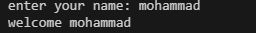
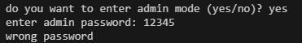
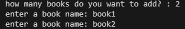
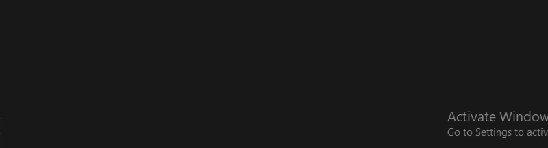

# Personal Book Manager

A simple book management program built with Python. It allows users to add books, display them, and save them for future use.


## Features

- Add multiple books
- Display the list of books
- Save books in a JSON file
- Load previously saved books
- Admin Mode with a password stored in an environment variable
- Add priority to books (Low, Medium, High)

## Book Priority

users can assign a priority to each book:
- Low
- Medium
- High


## Requirements

- Python
- python-dotenv

## Installation

Install the required packages:

```bash
pip install -r requirements.txt
```

## Environment Setup

Create a `.env` file in the project directory.

Use `.env.example` as a template and add your own password:

```dotenv
BOOK_MANAGER_ADMIN_PASSWORD=your_password_here
```

Replace `your_password_here` with your own password.

Do not upload your `.env` file to GitHub because it contains private configuration.

## Run the Program

Run the following command from the project directory:

```bash
python main.py
```

## Screenshot

### welcome


### admin mode


### getbook


## Demo


## Project Structure

```text
personal_book_manager/
├── main.py
├── books.py
├── .gitignore
├── .env.example
├── requirements.txt
├── README.md
└── images/
    ├── welcome.jpg
    ├── adminmode.jpg
    ├── getbook.jpg
    └── demo.gif
```

- `main.py`: Runs the program.
- `books.py`: Saves, loads, and shows books.
- `.gitignore`: Ignores some files.
- `.env.example`: Shows the password variable.
- `requirements.txt`: Contains the required packages.
- `images/`: Contains screenshots and the GIF.

## How It Works

1. The program asks for your name.
2. It welcomes you.
3. It asks if you want to use Admin Mode.
4. If you choose yes, it asks for your password.
5. It loads previously saved books.
6. You enter the number of books.
7. You enter the book names.
8. The program displays and saves your books.

## Troubleshooting

### 1. FileNotFoundError

- What is it? A file cannot be found.
- Why? The program may run from the wrong folder.
- What to check? Check that you are running the program from the project folder.

### 2. JSON Decode Error

- What is it? Python cannot read the JSON file.
- Why? The file may be empty or have incorrect content.
- What to check? Open `books.json` and check its content.

### 3. Module Not Found Error

- What is it? Python cannot find the `dotenv` package.
- Why? The package may not be installed.
- What to check؟ Run `pip install -r requirements.txt`.

### 4. Admin Password Not Working

- What is it? The admin password does not work.
- Why? The password or variable name may be incorrect.
- What to check? Check the password and variable name in your `.env` file.